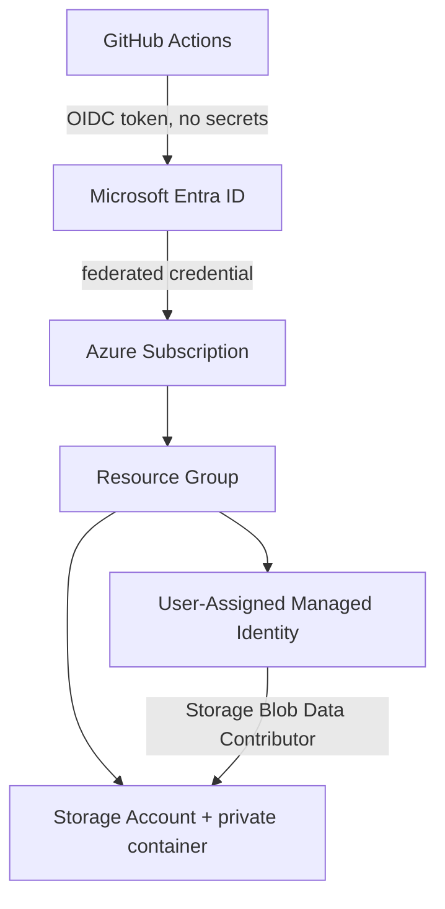

# Azure Terraform Lab


-success)

A hands-on **Infrastructure as Code** lab for Microsoft Azure — built to practise the patterns used in real cloud automation work:

- **Modular Terraform** (reusable resource-group and storage modules)
- **Secretless CI/CD** with GitHub Actions → Azure via **OIDC federated credentials** (no stored client secrets)
- **Least-privilege access** using a user-assigned **Managed Identity** and scoped RBAC
- **Safe defaults** — TLS 1.2 minimum, private containers, no shared-key access

---

## Architecture



| Resource | Purpose |
| --- | --- |
| Resource Group | Groups every lab resource, tagged and environment-scoped |
| Storage Account | TLS 1.2+, LRS, nested public access disabled, **shared key access disabled** |
| Blob Container | Private `reports` container |
| User-Assigned Managed Identity | Identity for automation jobs (no passwords or keys) |
| Role Assignment | Managed identity → `Storage Blob Data Contributor`, scoped to the storage account only |

---

## Repository structure

```
.
├── .github/workflows/
│   ├── terraform-plan.yml     # fmt + validate + plan on pull requests
│   └── terraform-apply.yml    # apply on main (gated by a GitHub environment)
└── terraform/
    ├── versions.tf            # provider & Terraform version constraints
    ├── providers.tf           # azurerm provider configuration
    ├── variables.tf           # inputs with validation
    ├── main.tf                # module composition + managed identity + RBAC
    ├── outputs.tf
    ├── terraform.tfvars.example
    └── modules/
        ├── resource-group/
        └── storage/
```

---

## Prerequisites

- An Azure subscription
- [Terraform](https://developer.hashicorp.com/terraform/install) ≥ 1.7
- [Azure CLI](https://learn.microsoft.com/cli/azure/install-azure-cli) ≥ 2.55
- Git and a GitHub account

---

## Configure OIDC for GitHub Actions (no client secrets)

```bash
# 1. Create an app registration for GitHub Actions
az ad app create --display-name "github-terraform-lab"

# 2. Add a federated credential for this repository's main branch
az ad app federated-credential create \
  --id <APP_OBJECT_ID> \
  --parameters '{
    "name": "github-main",
    "issuer": "https://token.actions.githubusercontent.com",
    "subject": "repo:ChanHei419/azure-terraform-lab:ref:refs/heads/main",
    "audiences": ["api://AzureADTokenExchange"]
  }'

# 3. Grant the app Contributor on the target subscription
az role assignment create \
  --assignee <APP_CLIENT_ID> \
  --role Contributor \
  --scope /subscriptions/<SUBSCRIPTION_ID>
```

Then add a repository secrets in GitHub → **Settings → Secrets and variables → Actions**:

| Secret | Value |
| --- | --- |
| `AZURE_CLIENT_ID` | App registration client ID |
| `AZURE_TENANT_ID` | Entra tenant ID |
| `AZURE_SUBSCRIPTION_ID` | Target subscription ID |

---

## Usage

```bash
cd terraform
cp terraform.tfvars.example terraform.tfvars   # adjust values
terraform init
terraform fmt -recursive
terraform validate
terraform plan
terraform apply
```

Outputs include the storage account name, container name, and the managed identity client ID — useful for wiring up follow-up automation.

### Clean up

```bash
terraform destroy
```

---

## CI/CD

| Workflow | Trigger | Steps |
| --- | --- | --- |
| `terraform-ci.yml` | Push / PR to `main` | `fmt -check` → `init -backend=false` → `validate` |
| `terraform-apply.yml` | Manual (`workflow_dispatch`) | OIDC login → `init` → `apply -auto-approve` |

The CI workflow needs no cloud credentials, so it always runs. The apply workflow is manual by design and authenticates with OIDC — **no long-lived Azure credentials** are stored in GitHub. Configure the secrets first (see above).

> For team use, switch to a remote backend by uncommenting the `backend "azurerm"` block in `versions.tf` and running `terraform init -backend-config=backend.hcl`.

---

## Cost

The lab uses a `Standard_LRS` storage account — a few cents per month. Run `terraform destroy` when you are done.

## What this lab practises

- Designing reusable Terraform modules with validated variables
- Provisioning Azure resources with secure defaults
- Secretless authentication (OIDC) and least-privilege RBAC
- Building CI/CD pipelines that gate infrastructure changes

## Author

**HeiChan (Chan Hei Lun)** — BEng in Information Engineering, CUHK
[github.com/ChanHei419](https://github.com/ChanHei419)
